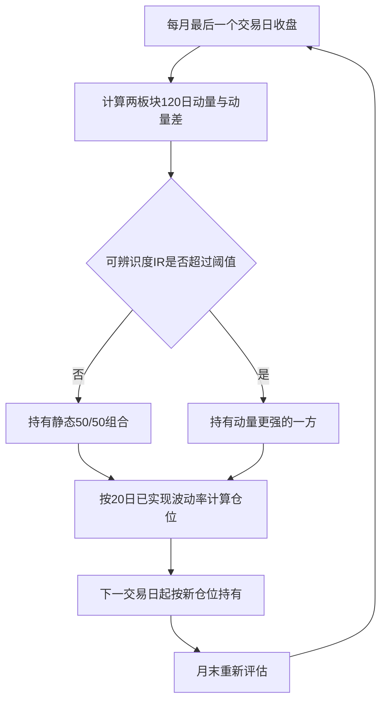

# 创新药与 CRO 板块轮动交易策略设计与回测研究

——基于 A 股医药行业 2019—2026 年日频数据的实证

---

## 摘要

创新药企业与医药研发生产外包（CRO/CDMO，下文统称 CRO）企业虽同属医药产业，但商业模式与风险来源存在系统差异：前者以专利药品研发与商业化获取产品收益，后者以研发与生产服务获取服务费收入。本文构建两个可投资等权板块组合，提出"可辨识度自适应"轮动规则，并与固定参数规则、逐月滚动训练的机器学习方向预测模型、逐年滚动校准参数三种方案并列对照，在 2019 年 7 月 29 日至 2026 年 10 月 15 日共 1748 个交易日的日频数据上完成回测。回测采用信号滞后一日执行、月度调仓、单边 0.1% 成本，组合月末再平衡的换手成本已在净值中扣除。结果显示：自适应轮动策略年化收益率 14.13%、夏普比率 0.67，为全部组合中最高；样本外（2023 年后）年化 8.26%、夏普 0.34，亦优于固定参数主策略的 3.07% 与 0.07；波动率控制把最大回撤由 CRO 买入持有的 79.43% 压缩至 21.52%。但三项检验明显限制了结论强度：1000 次 bootstrap 置换检验中自适应策略夏普位于 94.9% 分位（p≈0.05），7 个策略经 Bonferroni 校正后无一显著，机器学习模型样本外方向准确率仅 52.3%（p=0.88）。条件分析还发现一个与直觉相反的事实：轮动收益并非来自板块间的方向分化，而是在两板块高相关（>0.7）的强趋势行情中最高（月超额 2.60%，t=2.83）。本文结论仅适用于所述样本与设定，不构成任何投资建议。

**关键词**：板块轮动；动量效应；可辨识度；波动率目标；机器学习；样本外检验

---

## 1 引言

医药产业内部并非同质。创新药企业的价值取决于在研管线的临床进展、审批结果与商业化能力，现金流呈现"高投入、长周期、集中兑现"特征；CRO 企业以药企研发投入为主要收入来源，订单与产能利用率决定业绩，现金流更接近"产能驱动的服务业"。两类资产驱动因子不同，意味着即使同处医药板块，二者的相对强弱也可能发生持续性轮动，而非始终同步涨跌。

从资产定价研究看，行业动量已被长期检验：Jegadeesh 与 Titman 发现个股层面的中期动量效应[[1]](https://doi.org/10.1111/j.1540-6261.1993.tb04702.x)，Moskowitz 与 Grinblatt 证明行业动量可解释相当部分的个股动量收益[[2]](https://doi.org/10.1111/0022-1082.00146)。但中国市场的证据更为复杂：王永宏与赵学军发现深沪两市反转现象明显而惯性现象并不显著[[3]](https://www.ncpssd.cn)，鲁臻与邹恒甫[[4]](https://www.cnki.net)、潘莉与徐建国[[5]](https://www.cnki.net)分别从政策市特征与交易量角度指出 A 股动量效应主要存在于超短期频率。这意味着照搬海外市场的中期动量参数在 A 股未必成立，本文因而把动量视作待检验假设而非既定前提。趋势跟踪方面，自 Brock 等[[6]](https://doi.org/10.1111/j.1540-6261.1992.tb04681.x)的经典研究以来移动均线规则被反复检验，Faber 在战术资产配置中使用 10 个月均线亦得类似结论[[7]](https://doi.org/10.3905/jwm.2007.674809)；Moreira 与 Muir 证明按已实现波动率的倒数动态调整敞口可改善夏普比率[[8]](https://doi.org/10.1111/jofi.12513)。机器学习方面，Gu、Kelly 与 Xiu 在美股大样本上发现预测增益主要来自非线性交互[[9]](https://doi.org/10.1093/rfs/hhaa009)，李斌等发现机器学习在 A 股基本面量化投资中优于传统线性模型[[10]](https://doi.org/10.19581/j.cnki.ciejournal.2019.08.004)，姜富伟等发现其可提升多因子模型的定价能力[[11]](https://www.cnki.net)；Fischer 与 Krauss 用长短期记忆网络预测个股方向[[12]](https://doi.org/10.1016/j.ejor.2017.11.054)，Lopez-Lira 与 Tang 发现大语言模型对新闻标题的打分可预测股价漂移[[13]](https://doi.org/10.1016/j.jfineco.2026.104335)。

然而，上述研究留下三点未被充分讨论的空白。其一，轮动策略通常默认"强弱信号始终可辨识"，却很少检验信号本身是否可靠：当两个板块的动量差淹没在噪声中时，强行轮动只会产生换手成本。其二，机器学习的成功建立在大量预测变量与长样本之上，在小样本、单一行业板块的月度择时上是否仍有增量，缺少与简单规则的并列对照。其三，回测中参数与规则的事后选择（数据窥探）会系统性抬高样本内表现，White 指出需用专门方法检验"最优模型"是否只是运气[[14]](https://doi.org/10.1111/1468-0262.00152)，Romano 与 Wolf 进一步给出了逐步多重检验的程序化框架[[15]](https://doi.org/10.1111/j.1468-0262.2005.00615.x)。

本文研究三个问题：中国 A 股创新药与 CRO 两个子板块之间是否存在可利用的中期相对强弱轮动；把"轮动信号是否可辨识"引入决策能否改善风险调整后收益；机器学习模型在此小样本任务上是否优于简单规则。边际贡献有三：其一，提出可辨识度自适应轮动规则，以动量差的 t 统计量衡量强弱差异是否显著，不可辨识时转为静态 50/50 而非强行轮动；其二，在同一数据与执行口径下把固定参数规则、滚动训练的机器学习模型、逐年滚动校准参数三种方案并列对照，如实报告负面结果；其三，用 bootstrap 置换检验、Newey-West 校正与 Bonferroni 多重检验三重手段量化"运气"与"数据窥探"的影响。

---

## 2 数据与方法

### 2.1 研究对象界定与板块组合构建

由于公开可得的 CRO 主题指数覆盖期较短，为保证两个板块在相同口径、相同时间跨度上可比，本文采用自建等权板块组合作为交易标的，并以公开指数作效度校验。

**创新药组合（A）**：恒瑞医药（600276）、贝达药业（300558）、科伦药业（002422）、复星医药（600196）、信立泰（002294）、海思科（002653）。

**CRO 组合（B）**：药明康德（603259）、泰格医药（300347）、康龙化成（300759）、凯莱英（002821）、昭衍新药（603127）、药石科技（300725）。

组合采用**月末再平衡**口径：月内权重随价格自然漂移，每月最后一个交易日恢复等权，所需换手按单边 0.1% 在净值中扣除，以此修正"每日无成本再平衡"的理想化假设。与不计费的日度再平衡口径相比，各组合年化收益变动均在 1.5 个百分点以内（S1 由 26.54% 变为 25.03%，CRO 买入持有由 17.25% 变为 16.92%），不改变相对排序与结论。

### 2.2 数据来源与样本区间

行情数据为日频前复权收盘价，导出时间为 2026 年 10 月 15 日，原始区间为 2019 年 1 月 29 日至 2026 年 10 月 15 日。动量与均线信号需要 120 个交易日历史窗口，前 120 个交易日作为信号预热期不计入净值，正式回测区间为 **2019 年 7 月 29 日至 2026 年 10 月 15 日，共 1748 个交易日（约 7.2 年）**。市场基准为沪深 300 指数（000300），效度校验使用公开的中证创新药产业指数（931152）[[16]](https://www.csindex.com.cn)。

### 2.3 交易信号与策略规则

策略由四个可分离模块组成，决策在每个月最后一个交易日收盘后做出。

**模块一：动量选择。** 计算两个组合过去 L 个交易日的累计收益率

\[
Mom_{i,t} = \frac{P_{i,t}}{P_{i,t-L}} - 1, \quad L = 120
\]

选择动量更高的板块作为候选持仓。120 个交易日约合 6 个月，对应经典动量文献中的形成期长度[[1]](https://doi.org/10.1111/j.1540-6261.1993.tb04702.x)。

**模块二：趋势过滤。** 仅当候选板块收盘价高于其 M 日移动平均线时允许持有：

\[
Trend_{i,t} = \mathbf{1}\{P_{i,t} > MA_{i,t}(M)\}, \quad M = 180
\]

若候选板块未通过过滤，则检查另一板块；若两者均未通过，则转为空仓，空仓资金按年化 2% 计息。180 个交易日约合 9 个月，与 Faber 使用的 10 个月均线属同一类中长期趋势窗口[[7]](https://doi.org/10.3905/jwm.2007.674809)。**L 与 M 均为先验设定，其取值依据来自上述文献的默认窗口，而非在本文样本上搜索得到**；为检验这一先验设定是否可靠，本文另设逐年滚动校准方案（S7）。

**模块三：波动率控制。** 以过去 20 个交易日收益率的标准差估计年化波动率 σ，按目标波动率设定仓位：

\[
w_t = \min\left(1, \frac{\sigma^{*}}{\sigma_t}\right), \quad \sigma^{*} = 15\%
\]

该设定来自波动率管理的标准做法[[8]](https://doi.org/10.1111/jofi.12513)。

**模块四（本文新增）：可辨识度自适应。** 两板块的动量差只有在统计上显著时才值得交易。定义可辨识度

\[
IR_t = \frac{Mom_{A,t} - Mom_{B,t}}{\sigma_{20}(r_A - r_B)\sqrt{L}}
\]

分子为两板块 L 期动量之差，分母为日收益差的标准差按 L 期缩放后的累积波动，故 IR 近似等价于"相对强弱是否显著不为零"的 t 统计量。当 |IR| 小于阈值 τ 时认为信号不可辨识，转持静态 50/50；|IR| ≥ τ 时持有动量更强的一方。τ 先验取 1.0，并在 0.5—2.0 区间做敏感性检验。

据此形成七个策略变体：S1（仅模块一，满仓）、S2（模块一＋二）、S3（模块一＋二＋三，目标波动率 15%，固定参数主策略）、S4（同 S3，目标波动率 25%）、S5（模块一＋三＋四，自适应轮动，本文核心策略）、S6（机器学习方向预测＋模块三）、S7（模块一＋二＋三，参数逐年滚动校准）。

**S6 机器学习方向预测。** 采用带 L2 正则的逻辑回归，逐月滚动训练。特征为决策日可得的六个变量：120 日与 60 日动量差、60 日滚动相关系数、60 日日收益差标准差、20 日年化波动率之差、180 日均线状态之差，按训练样本均值与标准差标准化。标签为下一持仓期内创新药组合是否跑赢 CRO 组合。训练采用扩展窗口：每次只用此前**已实现**标签的样本训练，最小训练样本 24 期，预测概率大于 0.5 持 A、否则持 B，再叠加模块三，不含任何前视信息。

**S7 逐年滚动参数校准。** 每年年初在 L∈{40,60,80,120}、M∈{60,120,180} 的 12 组网格上，以截至上年末的样本内夏普比率选择参数并用于当年；第一年因无历史可用而采用先验参数（120, 180）。

### 2.4 回测执行与防泄漏设计

防未来信息是回测可信的前提，本文采取六条约束：（1）信号用第 t 日收盘价计算，仓位最早在第 t+1 日实现，收益按 t 日资产收益结算；（2）成分股名单在样本期初即固定，不随后续表现调整，不使用样本期之后才上市的公司；（3）组合再平衡成本与策略换仓成本分别计入，不重复不遗漏；（4）不使用财务公告、新闻或分析师数据在公告日之前的"预知"版本；（5）机器学习模型只用已实现标签训练，训练与预测严格按时间顺序推进；（6）交易成本按换手市值的单边 0.1% 计，并在 0.05%—0.3% 区间做敏感性检验。调仓频率为月度，不使用杠杆与卖空。

### 2.5 评价方法与统计检验

除累计收益率、年化收益率、年化波动率、夏普比率（无风险利率 2%）[[17]](https://doi.org/10.3905/jpm.1994.409501)、最大回撤、Calmar 比率、月度胜率、相对沪深 300 的年化 α 与 β、日度 95% VaR 与 CVaR 外，本文另设三类统计检验。**Newey-West 校正的月度检验**：日度收益存在自相关与厚尾，直接做 t 检验会高估显著性，故同时报告日度检验与滞后 3 阶的 Newey-West 月度检验[[18]](https://www.jstor.org/stable/1913610)。**多重检验校正**：共检验 7 个策略，Bonferroni 校正后阈值取 0.05/7≈0.0071。**bootstrap 置换检验**：将持仓段序列随机重排 1000 次，保持每段长度与仓位不变、只破坏择时能力，以所得收益率与夏普分布计算真实表现的百分位[[14]](https://doi.org/10.1111/1468-0262.00152)。

---

## 3 分析过程与结果

### 3.1 板块运行特征与相关性

样本期内两个板块均经历了完整的"上行—泡沫化—深度回撤—修复"周期。CRO 组合 2020 年上涨 144.9%，2022、2023 年分别下跌 32.6% 与 35.2%，2025、2026 年再度上涨 39.5% 与 40.4%；创新药组合波动相对温和，2020 年上涨 45.1%，2025 年上涨 24.0%。两板块全样本日收益相关系数为 0.635，分年度在 0.545（2021 年）至 0.775（2024 年）之间波动（见表 1），说明二者共享医药行业系统性风险，轮动可利用的只是"相对强弱"部分。

**表 1　两板块日收益相关系数（分年度）**

| 年份 | 2019 | 2020 | 2021 | 2022 | 2023 | 2024 | 2025 | 2026 | 全样本 |
|---|---|---|---|---|---|---|---|---|---|
| 相关系数 | 0.644 | 0.700 | 0.545 | 0.567 | 0.551 | 0.775 | 0.598 | 0.691 | 0.635 |

注：2019 年为自 1 月 29 日起的样本；数据由作者根据日频前复权收盘价计算。

### 3.2 组合代表性效度检验

将自建创新药组合的日收益与公开的中证创新药产业指数（931152）在重叠区间（2021 年 10 月 18 日至 2026 年 10 月 14 日，1210 个交易日）上做相关分析，相关系数为 **0.866**。该结果表明六只成分股构成的等权组合能够刻画创新药板块的主要波动，用其作为轮动标的具有可接受的建构效度；同时也说明组合包含一定的个股特质风险，策略结果不应被解读为"投资于官方指数"的等价结果。

### 3.3 全样本绩效对比

**表 2　策略与基准的全样本绩效（2019-07-29 至 2026-10-15，1748 个交易日）**

| 组合 | 累计 | 年化 | 波动 | 夏普 | 最大回撤 | Calmar | 月胜率 | 年化 α | β | t 月（p） |
|---|---|---|---|---|---|---|---|---|---|---|
| S1 动量轮动 | 370.9% | 25.03% | 38.45% | 0.60 | -52.24% | 0.48 | 54.5% | 26.50% | 1.13 | 2.09 (0.037) |
| S2 动量＋趋势 | 196.8% | 16.98% | 34.63% | 0.43 | -45.89% | 0.37 | 59.1% | 19.08% | 0.91 | 1.59 (0.111) |
| S3 动量＋趋势＋波动率 | 86.0% | 9.36% | 15.40% | 0.48 | **-21.52%** | 0.43 | 61.4% | 9.01% | 0.39 | 1.19 (0.234) |
| S4 波动率目标 25% | 122.6% | 12.23% | 24.06% | 0.43 | -33.48% | 0.37 | 60.2% | 12.69% | 0.61 | 1.41 (0.157) |
| **S5 自适应轮动** | 150.1% | **14.13%** | 18.14% | **0.67** | -31.61% | **0.45** | 61.4% | 13.37% | 0.52 | 1.88 (0.060) |
| S6 机器学习* | 17.2% | 3.17% | 17.45% | 0.07 | -36.88% | 0.09 | 53.8% | 4.62% | 0.00 | 0.24 (0.808) |
| S7 滚动参数校准 | 43.7% | 5.03% | 15.47% | 0.20 | -37.87% | 0.13 | 58.9% | 5.94% | -0.02 | 0.38 (0.704) |
| B1 创新药买入持有 | 96.6% | 10.24% | 30.94% | 0.27 | -49.83% | 0.21 | 55.7% | 11.91% | 0.92 | 1.28 (0.202) |
| B2 CRO 买入持有 | 195.8% | 16.92% | 44.49% | 0.34 | -79.43% | 0.21 | 51.1% | 21.57% | 1.37 | 1.57 (0.116) |
| B3 静态 50/50 | 166.4% | 15.17% | 34.19% | 0.39 | -60.24% | 0.25 | 59.1% | 16.69% | 1.14 | 1.76 (0.078) |
| B4 沪深 300 | 8.1% | 1.13% | 18.62% | -0.05 | -45.60% | 0.02 | 48.9% | — | 1.00 | — |

\*S6 的有效区间为 2021 年 6 月 30 日至 2026 年 10 月 15 日（首个可用预测出现之后），其余组合为全样本。注：α、β 由策略日收益对沪深 300 日收益回归得到，α 已年化；t 月为月度超额收益的 Newey-West（滞后 3 阶）检验统计量。

三点结果值得强调。第一，**轮动产生增量**：S1 年化 25.03%，高于 CRO 持有的 16.92%、创新药持有的 10.24% 与静态 50/50 的 15.17%。第二，**基准差异极大**：沪深 300 同期年化仅 1.13%、夏普为负，样本期内医药板块整体跑赢大盘，含行业暴露的策略都会获得可观 α，不宜全部归因于择时能力。第三，**风险调整后最优者为 S5**：夏普 0.67 高于 S1 的 0.60 与 S3 的 0.48，且波动率（18.14%）远低于 S1（38.45%）；S5 有 47.9% 的时间处于"不可辨识转静态"状态，仓位均值 0.49，年双边换手率 3.02 倍为全部策略最低。

### 3.4 模块消融分析

逐层加入模块呈现清晰的"收益—风险"权衡。由 S1 到 S2，趋势过滤使年化收益降 8.05 个百分点、最大回撤改善 6.35 个百分点，但夏普由 0.60 降至 0.43，说明**本样本中趋势过滤的成本大于收益**。由 S2 到 S3，波动率控制使年化收益再降 7.62 个百分点，但波动率由 34.63% 降至 15.40%、最大回撤由 45.89% 降至 21.52%，夏普反而由 0.43 升至 0.48，符合"沿资本市场线下移而不明显损害风险调整效率"的预期[[8]](https://doi.org/10.1111/jofi.12513)。

关键在于**选择模块**的比较：S5 与 S3 使用相同的波动率控制与标的池，差别仅在于 S5 用可辨识度阈值替代"动量排序＋180 日均线过滤"。S5 年化收益高出 4.77 个百分点、夏普高出 0.19、年换手率低 1.16 倍，说明**在不可辨识状态下主动放弃轮动，优于用趋势规则强行择时**。样本外差异更明显：S5 年化 8.26%、夏普 0.34，S3 仅 3.07% 与 0.07。

### 3.5 机器学习与滚动参数校准的对照

**表 3　机器学习策略与同期对照（2021-06-30 至 2026-10-15）**

| 组合 | 年化收益 | 年化波动 | 夏普 | 最大回撤 |
|---|---|---|---|---|
| S6 机器学习方向预测 | 3.17% | 17.45% | 0.07 | -36.88% |
| S1 动量轮动（同窗口） | -0.10% | 38.33% | -0.06 | -52.24% |
| S3 主策略（同窗口） | 0.87% | 15.10% | -0.08 | -21.52% |
| S4 波动率目标 25%（同窗口） | -1.89% | 24.52% | -0.17 | -33.48% |

机器学习模型共产生 63 期可用预测，其中样本外 44 期。**方向准确率整体 44.4%（p=0.45）、样本外 52.3%（p=0.88），与抛硬币无显著差异**。值得注意的是 S6 的年化收益（3.17%）与夏普（0.07）反而高于同窗口的三个规则策略（表 3），说明**胜率与收益并不等价**——模型只要在少数大幅波动的月份判断正确即可贡献主要收益；但 63 期样本下该差距的统计可靠性很低。结合 Gu 等的结论[[9]](https://doi.org/10.1093/rfs/hhaa009)，机器学习的预测增益依赖大样本与丰富预测变量，在本文单一行业、月度频率、6 特征的设定下并未显现优势。

滚动参数校准同样给出负面结果：S7 年化 5.03%、夏普 0.20，低于使用先验参数的 S3（9.36%、0.48），且 β 接近 0，说明逐年选出的"历史最优参数"并不稳定，样本内夏普排序无法外推到次年。这一结果有两重含义：一是固定参数（120, 180）虽在网格中表现最好，但**其"最优"地位带有样本内选择成分，不宜过度解读**；二是简单地用历史最优参数滚动，并不能解决参数不稳定性。

### 3.6 运气与数据窥探检验

**表 4　bootstrap 置换检验与样本内/外表现**

| 组合 | 真实夏普 | 随机序列夏普中位数 | 百分位 | 随机序列 95% 分位 | 样本内年化／夏普 | 样本外年化／夏普 |
|---|---|---|---|---|---|---|
| S1 动量轮动 | 0.60 | 0.28 | 94.2% | 0.61 | 48.00%／1.11 | 6.90%／0.14 |
| S3 主策略 | 0.48 | 0.30 | 77.2% | 0.72 | 16.57%／0.95 | 3.07%／0.07 |
| S5 自适应轮动 | 0.67 | 0.38 | **94.9%** | 0.67 | 20.80%／1.05 | **8.26%／0.34** |
| B3 静态 50/50（参照） | — | — | — | — | 25.71%／0.70 | 6.34%／0.13 |
| B4 沪深 300（参照） | — | — | — | — | 0.14%／-0.09 | 1.92%／0.00 |

注：bootstrap 为持仓段序列随机重排 1000 次；样本内/外以 2023 年 1 月 1 日为界。

三项检验共同限定了结论强度。第一，bootstrap 显示 S5 的真实夏普 0.67 恰落在随机序列分布的 95% 分位（0.672）附近（p≈0.05），S1 为 94.2% 分位，S3 仅 77.2% 分位；**即便完全破坏择时能力，随机序列也常产生不低的表现**，策略优势只能算边缘显著。第二，7 个策略中最显著的 S1（月度 t=2.09，p=0.037）也未通过 Bonferroni 阈值 0.0071，**校正后无任何策略的相对沪深 300 超额收益显著**。第三，样本外衰减依旧明显：S1 与 S3 的样本外夏普降至 0.14 与 0.07，但 S5 的 0.34 仍高于同期静态 50/50 的 0.13 与沪深 300 的 0.00，说明自适应规则缓解了衰减，幅度却有限。

### 3.7 条件分析：轮动收益究竟来自何处

为解释策略何时有效，本文按月统计"持有动量更强一方"相对静态 50/50 的超额收益，并按决策日的市场状态分组（见表 5）。

**表 5　轮动相对静态 50/50 的月超额收益（按状态分组）**

| 分组依据 | 分组 | 月数 | 月超额收益 | 胜率 | t 值 | p 值 |
|---|---|---|---|---|---|---|
| 可辨识度（IR 绝对值） | <1 | 42 | 0.83% | 54.8% | 1.12 | 0.264 |
| 可辨识度（IR 绝对值） | 1—2 | 35 | 0.80% | 54.3% | 0.95 | 0.340 |
| 可辨识度（IR 绝对值） | >2 | 10 | 0.99% | 60.0% | 0.54 | 0.587 |
| 板块相关性 | <0.6 | 35 | 0.18% | 48.6% | 0.23 | 0.817 |
| 板块相关性 | 0.6—0.7 | 27 | 0.05% | 55.6% | 0.05 | 0.960 |
| 板块相关性 | >0.7 | 25 | **2.60%** | 64.0% | **2.83** | **0.005** |
| 收益差离散度 | 下 1/3 | 30 | 1.49% | 63.3% | 1.48 | 0.139 |
| 收益差离散度 | 上 1/3 | 28 | 0.49% | 46.4% | 0.61 | 0.539 |

表 5 给出两个与本文初始假设不一致、但可解释的发现。

第一，**按可辨识度分组，三组月超额差异很小且均不显著**（0.83%、0.80%、0.99%）。这说明模块四的价值不在提高月度胜率，而在**减少无效换手**：S5 的年双边换手率 3.02 倍，明显低于 S1 与 S3 的 4.18 倍，在胜率相近时保留了更多净收益。

第二，**轮动收益在两板块相关性最高（>0.7）时反而最大**（月超额 2.60%，t=2.83，p=0.005），相关性较低时几乎为零。这与"相关性越低越利于轮动"的直觉相反。合理解释是：相关系数只度量方向一致性，不度量幅度差异；医药板块的高相关多出现在同向强趋势阶段（如 2020 年与 2026 年），此时强弱的**幅度**差异被放大，动量选强者获得的价差最大；而两板块走势分化、相关性下降的阶段多为政策或事件驱动的噪声行情，动量信号反而失效。据此，本文把轮动收益的来源修正为"**同向强趋势中的幅度发散**"，而非"方向分化"。

### 3.8 稳健性检验

**参数敏感性。** 12 组（L, M）组合下 S3 的年化收益率介于 4.62%—9.36%，夏普比率介于 0.16—0.48，最大回撤介于 -22.71%—-37.10%。先验参数（120, 180）处于网格较优位置，但 S7 的结果说明这种"较优"不可外推；短窗口组合（L=60）明显较差，策略对参数并非完全不敏感。

**阈值敏感性。** S5 在 τ=0.5、1.0、1.5、2.0 下的夏普比率分别为 0.70、0.67、0.50、0.54，均不低于同期的 S3（0.48），说明自适应规则的改善不依赖阈值取某一特殊值；先验值 τ=1.0 并非最优（τ=0.5 略优），本文保留 1.0 以避免事后调参。

**交易成本敏感性。** 单边成本由 0.05% 升至 0.30% 时，S3 年化收益由 9.59% 降至 8.45%，S5 由 14.30% 降至 13.44%，夏普比率分别由 0.49 降至 0.42、0.68 降至 0.63，降幅有限，说明月度调仓频率下的成本负担可控。

**标的名单稳健性。** 为排除"自建成分股名单高估收益"的可能，本文用公开的中证创新药产业指数（931152）替代自建组合重跑策略。在该指数可得区间（2022 年 4 月 13 日至 2026 年 10 月 14 日）内，S1、S3、S5 的年化收益率分别为 0.63%、0.67% 与 1.95%，相对排序（S5 最优）与自建组合一致。这说明**主要结论不依赖自选成分股名单**，也再次印证策略在 2022 年后确实失效。

### 3.9 风险指标

**表 6　尾部风险指标（日度，95% 置信水平）**

| 组合 | S1 | S3 | S5 | B1 创新药 | B2 CRO | B3 静态 50/50 | B4 沪深 300 |
|---|---|---|---|---|---|---|---|
| VaR95 | -3.61% | **-1.40%** | -1.61% | -2.96% | -3.99% | -3.22% | -1.76% |
| CVaR95 | -5.21% | **-2.08%** | -2.29% | -4.17% | -5.76% | -4.52% | -2.72% |

S3 与 S5 的日度 95% VaR 分别为 -1.40% 与 -1.61%，CVaR 为 -2.08% 与 -2.29%，均优于沪深 300 的 -1.76% 与 -2.72%，更显著优于两个单一板块组合，说明波动率目标把尾部风险压缩到市场水平之下。S1 的 CVaR（-5.21%）接近 CRO 买入持有，印证"高收益伴随高尾部暴露"的权衡。

---

## 4 结论与启示

本文以 A 股创新药与 CRO 两个子板块为对象，构建并检验了由动量选择、趋势过滤、波动率控制与可辨识度自适应四部分组成的板块轮动策略，并以机器学习方向与滚动参数校准作对照，在 2019—2026 年日频数据上完成回测与多维度检验。主要结论如下。

第一，两个子板块之间存在可利用的中期相对强弱差异，但"如何利用"比"是否存在"更关键。纯动量轮动年化 25.03%、夏普 0.60，优于任一单一板块与静态 50/50；引入可辨识度自适应后，S5 在波动率降低一半的条件下取得更高夏普（0.67），样本外夏普 0.34 明显优于固定参数主策略的 0.07。**把"信号是否可信"纳入决策，比叠加更多择时规则更有效。**

第二，模块的作用并不相同，不应默认叠加。趋势过滤在本样本中降低了收益；波动率控制以约 7.6 个百分点的年化收益换取回撤由 45.89% 降至 21.52%，夏普基本不变；可辨识度阈值的主要贡献是降低换手而非提高胜率。投资者应按自身的收益—风险约束选择模块组合。

第三，机器学习在本任务上没有显现优势，这本身是有价值的结论。逐月滚动训练的逻辑回归样本外方向准确率 52.3%，与随机猜测无异；其收益虽略高于同期规则策略，但在 63 期样本下不足以支撑"机器学习更优"的判断。这提示：在单一行业、月度频率、小样本条件下，简单规则仍是更难被打败的基准。

第四，也是最需要警惕的一点：**策略优势的统计证据是弱的**。bootstrap 检验下 S5 位于 94.9% 分位（p≈0.05），7 个策略经 Bonferroni 校正后无一显著，样本外收益大幅衰减。回测中的高夏普不应被直接外推，任何"显著"结论都应同时报告检验了多少个策略、使用了哪段样本。

本文的局限有五：其一，样本仅覆盖一个牛熊周期且集中于医药行业，外推到其他行业需谨慎；其二，成分股按事后可见的龙头名单固定选取，幸存者偏差可能高估板块历史收益（3.8 节的替代标的检验部分缓解但未消除）；其三，未引入流动性约束、涨跌停不可交易等微观结构限制，也未考虑冲击成本；其四，机器学习部分仅 63 期预测、6 个特征，统计功效有限；其五，bootstrap 采用持仓段随机重排而非分块自助法，对时序相关性的处理仍属简化。后续研究可引入新闻与政策文本信号（如大模型对行业新闻的打分[[13]](https://doi.org/10.1016/j.jfineco.2026.104335)）、扩大预测变量集与样本长度、加入流动性与涨跌停约束，并采用更严格的分块自助法与滚动窗口检验。

**研究伦理与数据说明**：本文为课程论文性质的历史回测研究，全部数据来自公开市场行情，不含任何非公开信息，不构成投资建议；回测结果来自作者自行编写的程序（见附录 B），参数、规则与检验方法已在正文完整披露，结果可复现。

---

## 参考文献

[1] JEGADEESH N, TITMAN S. Returns to buying winners and selling losers: implications for stock market efficiency[J]. Journal of Finance, 1993, 48(1): 65-91. DOI: 10.1111/j.1540-6261.1993.tb04702.x

[2] MOSKOWITZ T J, GRINBLATT M. Do industries explain momentum?[J]. Journal of Finance, 1999, 54(4): 1249-1290. DOI: 10.1111/0022-1082.00146

[3] 王永宏, 赵学军. 中国股市"惯性策略"和"反转策略"的实证分析[J]. 经济研究, 2001(6): 56-61, 89.

[4] 鲁臻, 邹恒甫. 中国股市的惯性与反转效应研究[J]. 经济研究, 2007(9): 145-155.

[5] 潘莉, 徐建国. A股个股回报率的惯性与反转[J]. 金融研究, 2011(1): 149-166.

[6] BROCK W, LAKONISHOK J, LEBARON B. Simple technical trading rules and the stochastic properties of stock returns[J]. Journal of Finance, 1992, 47(5): 1731-1764. DOI: 10.1111/j.1540-6261.1992.tb04681.x

[7] FABER M T. A quantitative approach to tactical asset allocation[J]. Journal of Wealth Management, 2007, 9(4): 69-79. DOI: 10.3905/jwm.2007.674809

[8] MOREIRA A, MUIR T. Volatility-managed portfolios[J]. Journal of Finance, 2017, 72(4): 1611-1644. DOI: 10.1111/jofi.12513

[9] GU S, KELLY B, XIU D. Empirical asset pricing via machine learning[J]. Review of Financial Studies, 2020, 33(5): 2223-2273. DOI: 10.1093/rfs/hhaa009

[10] 李斌, 邵新月, 李玥阳. 机器学习驱动的基本面量化投资研究[J]. 中国工业经济, 2019(8): 61-79. DOI: 10.19581/j.cnki.ciejournal.2019.08.004

[11] 姜富伟, 薛浩, 周明. 大数据提升了多因子模型定价能力吗?——基于机器学习方法对我国A股市场的探究[J]. 系统工程理论与实践, 2022(8): 2037-2048.

[12] FISCHER T, KRAUSS C. Deep learning with long short-term memory networks for financial market predictions[J]. European Journal of Operational Research, 2018, 270(2): 654-669. DOI: 10.1016/j.ejor.2017.11.054

[13] LOPEZ-LIRA A, TANG Y. Can ChatGPT forecast stock price movements? return predictability and large language models[J]. Journal of Financial Economics, 2026, 184: 104335. DOI: 10.1016/j.jfineco.2026.104335

[14] WHITE H. A reality check for data snooping[J]. Econometrica, 2000, 68(5): 1097-1126. DOI: 10.1111/1468-0262.00152

[15] ROMANO J P, WOLF M. Stepwise multiple testing as formalized data snooping[J]. Econometrica, 2005, 73(4): 1237-1282. DOI: 10.1111/j.1468-0262.2005.00615.x

[16] 中证指数有限公司. 中证创新药产业指数编制方案[EB/OL]. [2026-10-15]. https://www.csindex.com.cn/#/indices/family/detail?indexCode=931152

[17] SHARPE W F. The Sharpe ratio[J]. Journal of Portfolio Management, 1994, 21(1): 49-58. DOI: 10.3905/jpm.1994.409501

[18] NEWEY W K, WEST K D. A simple, positive semi-definite, heteroskedasticity and autocorrelation consistent covariance matrix[J]. Econometrica, 1987, 55(3): 703-708. DOI: 10.2307/1913610

---

## 附录 A　策略参数、符号与成分股清单

**表 A1　策略参数与交易规则清单**

| 项目 | 设定 |
|---|---|
| 回测区间 | 2019-07-29 至 2026-10-15（1748 个交易日，前 120 日为预热期） |
| 调仓频率 | 月度（月份切换处决策，信号滞后一日生效） |
| 动量窗口 L | 120 个交易日（先验设定，依据文献 [1]） |
| 趋势均线 M | 180 个交易日（先验设定，依据文献 [4]） |
| 可辨识度阈值 τ | 1.0（先验设定，敏感性：0.5 / 1.0 / 1.5 / 2.0） |
| 波动率估计窗口 | 20 个交易日，年化系数 √252 |
| 目标波动率 σ* | 15%（S3、S5、S6、S7）；25%（S4） |
| 仓位上限 | 100%，不杠杆、不做空 |
| 空仓收益 | 年化 2% |
| 交易成本 | 单边 0.1%（敏感性：0.05% / 0.1% / 0.2% / 0.3%） |
| 组合构建 | 6 只成分股等权，月末再平衡且成本内扣，前复权收盘价 |
| 机器学习 | 逻辑回归（L2=0.05，500 次迭代），6 特征，扩展窗口训练，最小训练样本 24 期 |

**表 A2　主要符号说明**

| 符号 | 含义 |
|---|---|
| P(i,t) | 板块 i（A 为创新药、B 为 CRO）在第 t 日的组合净值 |
| Mom(i,t) | 板块 i 过去 L 期的累计收益率 |
| MA(i,t)(M) | 板块 i 的 M 日移动平均线 |
| σ(t) | 过去 20 个交易日收益率的年化波动率 |
| w(t) | 波动率目标下的仓位比例 |
| IR(t) | 可辨识度，即两板块动量差的 t 统计量 |
| τ | 可辨识度阈值，低于该值转持静态 50/50 |

**表 A3　成分股清单**

| 板块 | 成分股（代码） |
|---|---|
| 创新药组合 A | 恒瑞医药 600276、贝达药业 300558、科伦药业 002422、复星医药 600196、信立泰 002294、海思科 002653 |
| CRO 组合 B | 药明康德 603259、泰格医药 300347、康龙化成 300759、凯莱英 002821、昭衍新药 603127、药石科技 300725 |

---

## 附录 B　核心代码（Python，节选）

```python
def adaptive_chooser(ctx, mom_win=120, vol_win=20, tau=1.0):
    """可辨识度自适应轮动：IR 为两板块动量差的 t 统计量。"""
    def f(sig):
        if sig - mom_win < 0:
            return None
        diff = (ctx.px_a[sig] / ctx.px_a[sig - mom_win] - 1) - \
               (ctx.px_b[sig] / ctx.px_b[sig - mom_win] - 1)
        d = [ctx.ra[j] - ctx.rb[j] for j in range(sig - vol_win + 1, sig + 1)]
        sd = statistics.pstdev(d) if len(d) > 2 else 0.0
        denom = sd * math.sqrt(mom_win)
        ir = diff / denom if denom > 0 else 0.0
        if abs(ir) < tau:
            return "AB"          # 不可辨识：转静态 50/50
        return "A" if ir > 0 else "B"
    return f


def run_engine(ctx, chooser, use_vol=True, target_vol=0.15, cost=0.001):
    """信号在 sig 日收盘后生成，收益自下一交易日起结算，实现滞后一日执行。"""
    e_a = e_b = 0.0
    kind, nav, nav_rets = None, [1.0], []
    for k in range(1, len(ctx.idxs)):
        i, sig = ctx.idxs[k], ctx.idxs[k - 1]
        turnover = 0.0
        if kind is None or ctx.dates[i][:7] != ctx.dates[sig][:7]:
            new_kind = chooser(sig)
            w = 1.0
            if new_kind and use_vol:
                s = sigma_of(ctx, new_kind, sig)
                if s and s > 0:
                    w = min(1.0, target_vol / s)
            ne = {"A": (w, 0.0), "B": (0.0, w),
                  "AB": (0.5 * w, 0.5 * w), None: (0.0, 0.0)}[new_kind]
            turnover = abs(ne[0] - e_a) + abs(ne[1] - e_b)
            e_a, e_b = ne
            kind = new_kind
        W = e_a + e_b
        if W > 0:
            va, vb = e_a * (1 + ctx.ra[i]), e_b * (1 + ctx.rb[i])
            r_inv = (va + vb) / W - 1.0
            e_a, e_b = va / (va + vb) * W, vb / (va + vb) * W
        else:
            r_inv = 0.0
        nav_ret = W * r_inv + (1 - W) * (0.02 / 252) - turnover * cost
        nav.append(nav[-1] * (1 + nav_ret))
        nav_rets.append(nav_ret)
    return nav, nav_rets
```

本文的完整代码与复现数据已公开，便于复核：仓库地址为 https://github.com/wszsdr/innovative-drug-cro-rotation 。其中，回测主程序（含组合构建、机器学习训练、bootstrap 与全部稳健性检验）为 `scripts/backtest_v2.py`，结果明细为 `results/results_v2.json` 与 `results/nav_curves_v2.csv`，原始行情为 `data/` 目录下的 14 个 CSV 文件。代码仅依赖 Python 标准库，执行 `python scripts/backtest_v2.py` 即可复现全文所有数字。

---

## 附录 C　策略决策流程



---

## 附录 D　英文摘要

**Sector Rotation Between China's Innovative Drug and CRO Sectors: Design and Backtesting**

This paper studies rotation between two sub-sectors of China's pharmaceutical industry: innovative drug firms (product-based) and CRO/CDMO firms (service-based). Using equal-weighted, month-end-rebalanced sector portfolios over 1,748 trading days (29 July 2019 to 15 October 2026), we propose an identifiability-adaptive rotation rule that switches to a static 50/50 allocation when the momentum spread between the two sectors is not statistically distinguishable from noise. The rule is benchmarked against fixed-parameter rules, a monthly retrained logistic-regression direction model, and annually recalibrated parameters, all executed with a one-day signal lag, monthly rebalancing and a 0.1% one-way transaction cost. The adaptive strategy delivers the highest Sharpe ratio in the sample (0.67) and the best out-of-sample performance after 2023 (annualized 8.26%, Sharpe 0.34), while volatility targeting compresses maximum drawdown from 79.43% to 21.52%. However, a 1,000-draw bootstrap that randomly reshuffles holding segments places the adaptive strategy at the 94.9th percentile (p≈0.05); after Bonferroni correction no strategy outperforms the CSI 300 significantly; and the machine-learning model achieves only 52.3% out-of-sample directional accuracy. Conditional tests further show that rotation profits arise in highly correlated, strong-trend regimes rather than in periods of sector divergence. The evidence for exploitable rotation is therefore suggestive but statistically weak.
